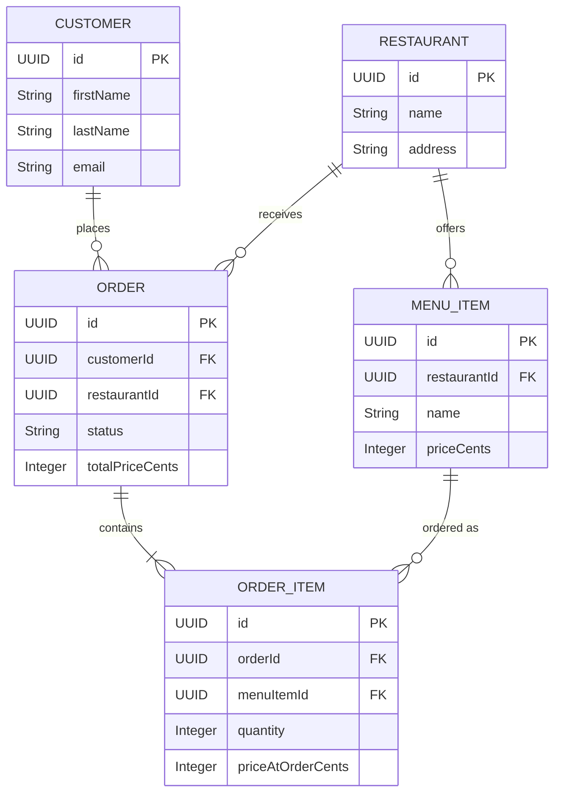

# Food Delivery API

A standalone REST API for a food-delivery market, backed by managed PostgreSQL.

## 1. Resource Design

### Customers
**Purpose:** Represents an end user who can place food delivery orders.
| Field | Type | Required/Optional | Description |
|---|---|---|---|
| `id` | UUID (v4) | Required (Generated) | Unique nonsequential identifier |
| `firstName` | String | Required | Customer's first name |
| `lastName` | String | Required | Customer's last name |
| `email` | String | Required | Customer's email address (unique) |
| `phone` | String | Optional | Customer's phone number |
| `createdAt` | DateTime | Required (Generated) | Timestamp of creation |
| `updatedAt` | DateTime | Required (Generated) | Timestamp of last update |

**Relationships:**
- Has many `Orders` (1:N)

### Restaurants
**Purpose:** Represents a business that prepares food and offers menu items.
| Field | Type | Required/Optional | Description |
|---|---|---|---|
| `id` | UUID (v4) | Required (Generated) | Unique nonsequential identifier |
| `name` | String | Required | Name of the restaurant |
| `description` | String | Optional | Brief description of the restaurant |
| `address` | String | Required | Physical location |
| `createdAt` | DateTime | Required (Generated) | Timestamp of creation |
| `updatedAt` | DateTime | Required (Generated) | Timestamp of last update |

**Relationships:**
- Has many `MenuItems` (1:N)
- Has many `Orders` (1:N)

### Menu Items
**Purpose:** Represents an individual food or drink item offered by a restaurant.
| Field | Type | Required/Optional | Description |
|---|---|---|---|
| `id` | UUID (v4) | Required (Generated) | Unique nonsequential identifier |
| `restaurantId` | UUID (v4) | Required | References the Restaurant |
| `name` | String | Required | Item name |
| `description` | String | Optional | Item description |
| `priceCents` | Integer | Required | Price in minor units (cents) |
| `currency` | String | Required | Explicit currency (e.g., 'USD', 'EUR') |
| `isAvailable`| Boolean | Optional (Default: true)| If the item is currently orderable |
| `createdAt` | DateTime | Required (Generated) | Timestamp of creation |
| `updatedAt` | DateTime | Required (Generated) | Timestamp of last update |

**Relationships:**
- Belongs to one `Restaurant` (N:1)
- Has many `OrderItems` (1:N)

### Orders
**Purpose:** Represents a customer's request to purchase menu items from a single restaurant.
| Field | Type | Required/Optional | Description |
|---|---|---|---|
| `id` | UUID (v4) | Required (Generated) | Unique nonsequential identifier |
| `customerId` | UUID (v4) | Required | References the Customer |
| `restaurantId` | UUID (v4) | Required | References the Restaurant |
| `status` | String | Required (Default: 'pending') | State of the order (`pending`, `accepted`, `preparing`, `out_for_delivery`, `delivered`, `cancelled`) |
| `totalPriceCents` | Integer | Required | Total price in minor units (cents) |
| `currency` | String | Required | Explicit currency |
| `createdAt` | DateTime | Required (Generated) | Timestamp of creation |
| `updatedAt` | DateTime | Required (Generated) | Timestamp of last update |

**Relationships:**
- Belongs to one `Customer` (N:1)
- Belongs to one `Restaurant` (N:1)
- Has many `OrderItems` (1:N)

### Order Items
**Purpose:** Represents a specific menu item and its quantity within a given order. Includes a price snapshot to ensure historical orders remain accurate when menu prices change.
| Field | Type | Required/Optional | Description |
|---|---|---|---|
| `id` | UUID (v4) | Required (Generated) | Unique nonsequential identifier |
| `orderId` | UUID (v4) | Required | References the Order |
| `menuItemId` | UUID (v4) | Required | References the Menu Item |
| `quantity` | Integer | Required | Number of this item ordered |
| `priceAtOrderCents`| Integer | Required | Price snapshot of a single item at time of order |
| `currency` | String | Required | Explicit currency |
| `createdAt` | DateTime | Required (Generated) | Timestamp of creation |
| `updatedAt` | DateTime | Required (Generated) | Timestamp of last update |

**Relationships:**
- Belongs to one `Order` (N:1)
- Belongs to one `MenuItem` (N:1)

### Relationship Diagram



## 2. Design Decisions

### Why these resources and relationships
The problem domain describes a food-delivery market. We need **Restaurants** offering food, which translates directly to **Menu Items**. We need **Customers** to act as users of the system. **Orders** bridge the gap, linking a Customer to a Restaurant. Since an order can consist of multiple distinct menu items in varying quantities, the **Order Item** join table is required. It allows orders to contain multiple items, each explicitly mapping to a menu item from the restaurant.

### Why generated identifiers (UUID v4)
Using UUIDs instead of sequential integers (like auto-incrementing IDs) for primary keys prevents identifier enumeration (e.g., users cannot guess how many orders or customers exist by looking at `id: 50`). They also make distributed system integration and database merging easier, as collisions are statistically negligible.

### Cursor vs. Offset Pagination
This API implements **Cursor Pagination**.
- **Why Cursor:** It provides stable pagination. If items are inserted or deleted while a client is paging through results, cursor pagination ensures no items are skipped or duplicated.
- **When Offset is Better:** Offset pagination is easier to implement for simple skipping and jumping to specific pages (e.g., "Go to page 10"). However, it degrades in performance on large datasets because the database must scan and skip rows, whereas cursors can use an indexed lookup (`WHERE id > :cursor`).

### Response Envelope
The API uses a consistent response envelope for both success and errors.
**Success:**
```json
{
  "data": { ... or [...] },
  "meta": { "nextCursor": "...", "hasNextPage": true, "totalCount": 150 }
}
```
**Error:**
```json
{
  "error": {
    "code": "VALIDATION_ERROR",
    "message": "Invalid pagination parameters."
  }
}
```
**Rationale:** Having a predictable structure makes client consumption easier. It cleanly separates the payload (`data`) from out-of-band information (`meta` like pagination, total counts) and ensures errors are structurally distinct and easily parsed.

## 3. Endpoints Documentation

All endpoints are prefixed with `/api/v1`.
Authentication is not required for read endpoints (and is out of scope for this minimal API).

### Rate Limits
The API restricts clients (by IP) to **100 requests per minute**.
- Exceeded requests receive an HTTP `429 Too Many Requests`.
- A `Retry-After` header is included in the response.

*(More detailed endpoint documentation will be appended below...)*
